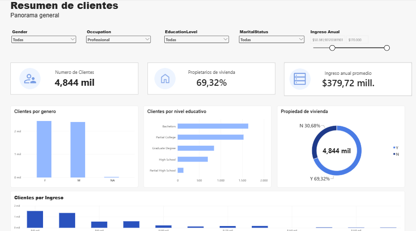

# Perfil y análisis de clientes

Dashboard creado en Power BI para explorar las características de los clientes y sus ingresos anuales.

## Objetivo

Visualizar información de los clientes para identificar cómo se distribuyen por género, nivel educativo, propiedad de vivienda e ingreso anual.

## Contenido del dashboard

- Número total de clientes
- Porcentaje de clientes propietarios de vivienda
- Ingreso anual promedio
- Clientes por género y nivel educativo
- Clientes por propiedad de vivienda
- Clientes agrupados por rangos de ingreso anual

## Herramientas

- Microsoft Power BI

## Archivos

- `perfil-analisis-clientes.pbix`: archivo del informe de Power BI
- 

## Fuente de datos

csv Clientes 

## Cómo abrir el informe

Descarga el archivo `.pbix` y ábrelo con Power BI Desktop.
